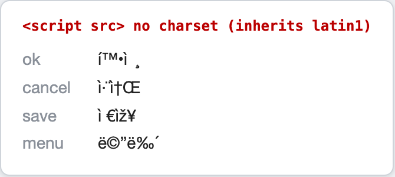
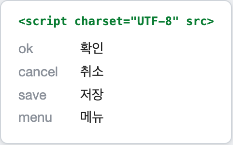

외부 `.js` 파일에 담아둔 한글 UI 라벨이 화면에서 `확ì¸` 같은 글자로 깨져 나왔다. 소스 파일을 열어보면 `"확인"`이라고 멀쩡하게 들어있는데도 그렇다.

"인코딩 어딘가 안 맞겠지, charset 붙이면 되겠지" 하고 넘어갈 수도 있다. 실제로 응답 헤더에 `charset=UTF-8`을 붙이니 고쳐졌다. 근데 여기서 좀 걸리는 게 있다. **HTML 표준상 `<script src>`로 불러온 외부 JS는 문서 인코딩을 상속하기 때문에, 페이지에 붙는 스크립트는 charset 헤더가 없어도 깨지지 않아야 한다.** 그런데 왜 내 라벨은 깨졌을까?

그래서 좀 파봤음.

(급하면 결론부터: `.js`를 **UTF-8 BOM으로 저장**하거나, **서버가 `charset=UTF-8` 헤더**를 붙이게 하면 끝난다. 왜 그런지가 궁금하면 계속 읽으면 된다.)

<!--more-->

## 1. 재현 데모

같은 깨짐을 직접 재현해볼 수 있다. 파일 3개면 된다.

`labels.js` (UTF-8로 저장):

```javascript
var LABELS = {
  ok: "확인",
  cancel: "취소",
  save: "저장",
  menu: "메뉴"
};
```

`broken.html` — 문서를 일부러 latin1로 선언했다. 한국의 오래된 페이지가 EUC-KR이나 latin1로 선언돼 있는 상황을 흉내낸 것이다.

```html
<!DOCTYPE html>
<html>
<head>
  <meta charset="ISO-8859-1">
</head>
<body>
  <script src="labels.js"></script>
  <div id="out"></div>
  <script>
    var out = document.getElementById('out');
    for (var k in LABELS) {
      out.innerHTML += '<div>' + k + ': ' + LABELS[k] + '</div>';
    }
  </script>
</body>
</html>
```

브라우저로 열면 이렇게 깨진다.



`확인`이 `확ì¸`로 나왔다. 소스는 UTF-8 그대로인데 말이다.

> 재현 팁: 이 데모는 `file://`로 파일을 직접 열면 응답 헤더가 없어서 **항상** 재현된다. HTTP 서버로 서빙하는 중이라면, 그 서버가 `.js`에 charset을 붙이지 않아야 재현된다. 서버가 `Content-Type: text/javascript; charset=UTF-8`을 자동으로 붙이면 그게 곧 아래 해결책(서버 charset 헤더)이라 애초에 안 깨진다.

## 2. 깨진 글자를 바이트로 되돌려보기

깨진 화면만 보고도 "어느 인코딩으로 잘못 읽혔는지" 역추적할 수 있다. 방법은 간단하다. **깨진 글자를 다시 바이트로 되돌려 보는 것이다.** 이건 이 글의 `.js` 문제에만 쓰는 게 아니라, DB든 파일이든 **어떤 한글 깨짐이든** 원인을 좁힐 때 그대로 통하는 방법이다. 원인 짐작이 안 되면 여기부터 시작하면 된다.

`확인`을 UTF-8로 인코딩하면 이렇게 된다.

| 글자 | 유니코드 | UTF-8 바이트 | 오독된 글리프 |
|------|----------|--------------|----------------|
| 확   | U+D655   | `ED 99 95`   | `í ™ •`       |
| 인   | U+C778   | `EC 9D B8`   | `ì ¸` (+제어문자) |
| 확인 | —        | `ED 99 95 EC 9D B8` | `확ì¸` |

`ED`를 latin1(정확히는 windows-1252)로 읽으면 `í`, `99`는 `™`, `95`는 `•`… 이렇게 UTF-8 3바이트가 각각 한 글자씩 풀려서 `확`이 된다. 화면에 뜬 깨진 글자가 바로 이 매핑과 정확히 일치한다. **즉 "UTF-8 바이트를 latin1으로 읽었다"가 확정된다.**

파이썬 한 줄이면 검증 끝이다.

```python
>>> "확인".encode("utf-8").decode("latin1")
'í\x99\x95ì\x9d¸'   # 브라우저(windows-1252)에선 \x99=™, \x95=• 로 보여 확ì¸
```

> 여담: 깨진 글자에 `•`(0x95)나 `™`(0x99)이 보이면 순수 ISO-8859-1이 아니라 **windows-1252(CP1252)** 다. 이 영역(0x80~0x9F)은 latin1에선 제어문자지만 CP1252에선 문장부호로 채워져 있다. 브라우저는 페이지가 `ISO-8859-1`이라고 선언해도 실제로는 windows-1252로 처리한다 — HTML 명세가 그렇게 하도록 정하고 있다.

## 3. 한글이 깨졌는데, 스크립트는 원래 안 깨져야 한다고?

여기서 처음의 의문으로 돌아온다. [HTML 명세](https://html.spec.whatwg.org/multipage/scripting.html#scriptingLanguages)에 따르면 `<script src>`로 불러온 외부 스크립트는 응답에 charset이 없으면 **문서(document)의 인코딩을 상속**한다. 그리고 HTML5 문서의 기본 인코딩은 UTF-8이다. 그러니 "charset 없는 .js"는 UTF-8 문서에 붙는 한 깨질 이유가 없다.

원인은 이 상속이다. **내 문서가 UTF-8이 아니었던 것이다.** 데모에서 `<meta charset="ISO-8859-1">`로 선언한 문서에 UTF-8 스크립트를 붙였더니, 스크립트가 문서의 latin1을 물려받아 UTF-8 바이트를 latin1으로 읽어버렸다.

한국의 레거시 웹앱에서 이 조합은 아주 흔하다. 페이지들은 옛날에 EUC-KR/MS949로 만들어졌는데, 나중에 추가한 라벨 파일(예: `labels.js`)만 UTF-8로 저장하면, 스크립트가 페이지의 옛 인코딩을 상속하면서 딱 이렇게 깨진다.

## 4. 해결

핵심은 "문서 인코딩 상속(3절)까지 굴러떨어지기 전에, 그 위 어딘가에서 UTF-8을 확정해주는 것"이다. 브라우저가 외부 스크립트의 인코딩을 정하는 우선순위가 정해져 있는데, 이 중 하나만 잡아주면 된다.

| 우선순위 | 방법 |
|----------|------|
| 1 (최상) | `.js`에 UTF-8 **BOM** |
| 2 | HTTP 응답 헤더 **`Content-Type; charset=UTF-8`** |
| 3 | `<script charset="UTF-8">` 속성 |
| 4 (최하·fallback) | 문서 인코딩 상속 |

**(1) `.js`를 UTF-8 BOM으로 저장 (가장 강력)**

파일 맨 앞에 BOM(`EF BB BF`)이 있으면 브라우저가 헤더·문서 인코딩과 상관없이 UTF-8로 인식한다. 파일 하나만 고치면 되고 서버 설정은 안 건드려도 된다. 다만 도구에 따라 BOM을 싫어하는 경우가 있으니 그때는 (2)로 간다.

**(2) 서버 응답 헤더에 charset 명시 (정공법)**

```
Content-Type: text/javascript; charset=UTF-8
```

Apache면 `AddCharset UTF-8 .js`(또는 `AddDefaultCharset UTF-8`), nginx면 `charset utf-8;`. 헤더가 붙었는지는 이렇게 확인한다.

```bash
curl -sI https://example.com/labels.js | grep -i content-type
```

**(3) `<script>` 태그에 charset 지정 (태그 단위 임시 방편)**

```html
<script charset="UTF-8" src="labels.js"></script>
```

문서 인코딩 상속을 태그 단위로 덮어쓴다. 데모의 `fixed.html`이 이 방법이고, 결과는 이렇다.



**(4) 문서 자체를 UTF-8로 바로잡기 (근본이지만 범위 큼)**

애초에 페이지가 UTF-8이면 상속받아도 문제가 없다. 다만 레거시 페이지의 인코딩을 통째로 바꾸는 건 다른 곳의 인라인 한글까지 영향을 주므로 범위가 크다.

## 5. 정리 — 이런 순서로 의심하자

한글이 깨질 때 무작정 charset부터 만지지 말고, 이렇게 좁혀 들어가면 원인이 명확해진다.

1. **깨진 글자를 바이트로 되돌려 본다.** `깨진문자.encode("latin1").decode("utf-8")`로 원래 글자가 복원되면 "UTF-8을 latin1으로 읽은 것"이 확정된다.
2. **소스 파일 자체는 멀쩡한지** 확인한다. 멀쩡하면 데이터가 아니라 "읽는 쪽(디코딩)" 문제다.
3. 외부 스크립트가 원인이면, 그 스크립트가 **어느 문서에 붙어 있는지, 그 문서의 인코딩이 무엇인지** 본다. `<script>`는 (BOM·헤더·charset 속성이 없으면) 문서 인코딩을 상속한다는 점을 기억하자.
4. BOM이나 응답 헤더 `charset`으로 못박는다.

증상은 흔하지만, "charset 붙이니 됐다"에서 멈추지 않고 바이트까지 내려가 보면 왜 그런지가 또렷하게 보인다.
