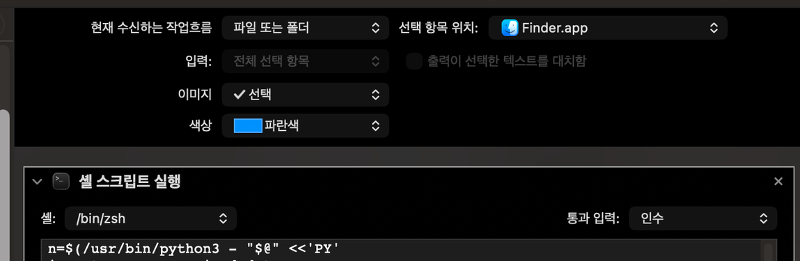

맥에서 만든 한글 파일을 남한테 보내면 이름이 `ㅎㅏㄴㄱㅡㄹ.txt`처럼 낱자로 쪼개져 보일 때가 있는데, 정작 내 맥에선 `한글.txt`로 멀쩡함. 이런 걸 자소분리라고 부름.

고치는 법이야 여러 글에 나와 있는데, 막상 따라 하다 보면 두 군데서 막힘. 하나는 "맥에서 그냥 압축해서 보냈는데 왜 여전히 깨지지?", 또 하나는 "우클릭 빠른 동작을 만들었는데 '0개'만 뜨고 안 바뀌던데?". 둘 다 이유가 분명함.

(급하면 결론부터: 그냥 보낼 파일이면 **Keka나 Bandizip으로 압축**하면 끝남. 맥 기본 압축은 안 고쳐주니 주의. 파일 이름 자체를 고쳐두고 싶으면 아래 **Finder 빠른 동작**을 하나 만들어두면 우클릭으로 끝남. 만들었는데 '0개'만 뜨면, 십중팔구 Automator 입력 전달이 'stdin'이라 그런 거임 — '인수로'로 바꾸면 됨.)

<!--more-->

## 1. 자소분리가 뭔가

한글 한 글자를 저장하는 방법이 두 가지 있음.

- **NFC**: `한`을 한 글자로 붙여서 저장 — 윈도우·리눅스가 쓰는 방식.
- **NFD**: `한`을 `ㅎ`+`ㅏ`+`ㄴ` 낱자로 쪼개서 저장 — 맥이 쓰는 방식.

NFC, NFD는 유니코드 정규화 형식(Normalization Form)의 종류인데, 끝 글자가 각각 Composition(붙이기)과 Decomposition(쪼개기)이라 그렇게 부름.

맥은 파일 이름을 NFD로 저장하는데, 화면엔 다시 붙여서 `한글.txt`로 보여주니 내 맥에선 문제가 없음. 근데 저장된 바이트는 쪼개진 상태라, NFC만 아는 환경(윈도우·리눅스·웹 업로드)으로 넘어가면 낱자가 그대로 보임 — 그게 `ㅎㅏㄴㄱㅡㄹ.txt`임.

<details markdown="1">
<summary>그런데 맥은 왜 하필 NFD로 저장할까? (펼쳐보기)</summary>

파일시스템은 두 이름이 같은 이름인지 판별해야 하는데(중복 방지, 대소문자 무시 비교 등), 유니코드에선 같은 글자를 NFC(`한`)로도 NFD(`ㅎ`+`ㅏ`+`ㄴ`)로도 쓸 수 있음. 눈엔 같은데 바이트가 다르면 곤란하니, 저장할 때 한 가지 형태로 통일해두고 비교하는 게 안전함. 그래서 맥의 옛 파일시스템 **HFS+**(1998)가 그 형태로 NFD를 골라 이름을 쪼개서 저장한 거임.

왜 NFC가 아니라 NFD였을까? 유니코드는 새 완성 글자를 계속 추가해서 NFC 기준은 버전마다 흔들리는데, 분해 규칙은 안정적이라 디스크에 저장된 이름이 OS 업데이트에 휘둘리지 않음(HFS+는 분해 규칙을 아예 유니코드 3.2에 고정해둠). 요즘 **APFS**는 이 강제를 안 하지만, 그 위의 macOS 레이어가 옛 호환을 위해 여전히 이름을 NFD로 넘겨줘서 지금도 NFD로 저장됨.

</details>

말로만 하면 안 와닿으니, NFD 파일을 하나 만들어서 저장된 바이트를 직접 보자.

```bash
python3 -c "import unicodedata; open(unicodedata.normalize('NFD','한글.txt').encode('utf-8'),'w').close()"
python3 -c "import os; print([f for f in os.listdir(b'.') if f.endswith(b'.txt')][0])"
# b'\xe1\x84\x92\xe1\x85\xa1\xe1\x86\xab\xe1\x84\x80\xe1\x85\xb3\xe1\x86\xaf.txt'
```

`한글`이 NFC면 6바이트(`\xed\x95\x9c\xea\xb8\x80`)여야 하는데 낱자로 쪼개져 9바이트로 들어가 있음. 이게 NFD다.

## 2. 보낼 때 고치기 — 압축 앱이 제일 간단하다

자소분리는 보통 **파일을 압축해서 메일에 붙이거나 어디 올릴 때** 드러남. 그러니 압축하는 그 순간에 이름을 NFC로 바꿔주면 깔끔하게 끝나는데, 문제는 **맥 기본 압축이 그걸 안 해준다는 거임.**

NFD 파일을 여러 방식으로 압축해보고, 압축 파일 안에 들어간 이름의 바이트를 열어봤음.

| 압축 방법 | 압축 파일 안의 이름 | 결과 |
|---|---|---|
| Finder 우클릭 "압축" (`ditto` 엔진) | NFD 그대로 | ❌ 깨짐 |
| **Keka** | NFC로 변환 | ✅ |
| **Bandizip** | NFC로 변환 (기본값) | ✅ |

Finder의 "압축"(내부적으로 `ditto`를 씀)은 저장된 NFD 바이트를 그대로 담아버림.

```bash
python3 -c "import unicodedata; open(unicodedata.normalize('NFD','한글.txt').encode('utf-8'),'w').close()"
ditto -c -k --keepParent 한글.txt out.zip

python3 - <<'PY'
import zipfile, unicodedata
for i in zipfile.ZipFile('out.zip').infolist():
    s = i.filename
    if s.endswith('/'): continue
    print(s.encode('utf-8'),
          'NFC' if unicodedata.normalize('NFC',s)==s else 'NFD')
PY
# => NFD로 나온다
```

반면 **Keka**는 압축할 때 이름을 알아서 NFC로 바꿔줌(파일 하나든 폴더째든). **Bandizip 맥 버전은 아예 기본값이 NFC**라 신경 쓸 것도 없는데, 공식 문서에도 파일 이름을 NFC로 처리한다고 적혀 있고 굳이 NFD로 쓰는 옵션은 7.20부터 따로 생김.

그러니 그냥 보내는 게 목적이면 Keka나 Bandizip으로 압축하는 게 제일 속 편하다.

한 가지 헷갈리기 쉬운 게, 이렇게 만든 zip을 **맥에서 다시 풀어** 확인하면 파일 이름이 도로 NFD로 보인다는 거임. 아카이브 유틸리티·Keka 같은 **GUI 앱으로 풀면 맥이 파일을 만들 때 NFD로 되돌리기 때문**인데(터미널 `ditto`·`unzip`으로 풀면 NFC 그대로), '압축→해제'로 테스트하면 "안 고쳐졌나?" 싶어도 **아카이브 자체는 NFC라 윈도우·리눅스에선 제대로 나옴.** 아카이브 안을 직접 확인하려면 `unzip -l 파일.zip | LC_ALL=C grep $'\xe1\x84'` 돌려서 아무것도 안 나오면 NFC임.

## 3. 파일 이름 자체를 고치기 (Finder 빠른 동작)

압축 말고 파일 이름 자체를 NFC로 바꿔두고 싶으면, 맥에선 **Finder 빠른 동작**으로 만들어서 우클릭 메뉴에서 바로 돌리는 게 제일 편함. 터미널 열 것 없이 파일이든 폴더든 우클릭 한 번이면 되고, Automator로 만들면 됨.

### Finder 빠른 동작으로 만들기 (Automator)

1. **Automator** 실행 → 새 문서 → 유형으로 **"빠른 동작"** 선택.
2. 상단에서 **"워크플로가 받는 현재 항목"을 "파일 또는 폴더"**, **"받는 위치"를 "Finder.app"** 으로 설정. 이래야 우클릭 메뉴에 뜨고 파일·폴더 양쪽에서 실행됨.
3. 왼쪽에서 **"셸 스크립트 실행"** 을 캔버스로 끌어다 놓고, **"통과 입력"을 "인수"(as arguments)** 로 바꿈. **이게 제일 중요함** — 기본값이 "stdin으로"라 그대로 두면 선택한 파일이 스크립트의 `"$@"`에 안 들어와서, 뭘 넣든 "0개"만 뜨고 아무것도 안 바뀜.
4. 스크립트 칸에 아래를 넣음. (셸은 기본값 `/bin/zsh` 그대로 둬도 되고 `/bin/bash`도 됨)
   ```bash
   n=$(/usr/bin/python3 - "$@" <<'PY'
   import os, sys, unicodedata
   nfc = lambda s: unicodedata.normalize('NFC', s)
   cnt = 0
   def fix(pathb):
       global cnt
       par = os.path.dirname(pathb) or b'.'
       want = nfc(os.fsdecode(os.path.basename(pathb)))
       real = next((e for e in os.listdir(par) if nfc(os.fsdecode(e)) == want), None)
       if real is None: return
       rp = os.path.join(par, real)
       if os.path.isdir(rp):
           for root, dirs, files in os.walk(rp, topdown=False):
               for nameb in files + dirs:
                   s = os.fsdecode(nameb)
                   if nfc(s) != s:
                       os.rename(os.path.join(root, nameb), os.path.join(root, os.fsencode(nfc(s)))); cnt += 1
       s = os.fsdecode(real)
       if nfc(s) != s:
           os.rename(rp, os.path.join(par, os.fsencode(nfc(s)))); cnt += 1
   for a in sys.argv[1:]:
       fix(os.fsencode(a))
   print(cnt)
   PY
   )
   osascript -e "display notification \"${n:-0}개 이름을 NFC로 바꿨어요\" with title \"자소분리 수정\""
   ```
   - 하는 일: 넘겨받은 파일·폴더에서 **디렉토리에 실제 저장된 이름을 직접 읽어**(`os.listdir`), NFD면 NFC로 바꿈(rename). 폴더는 안쪽까지 훑음. 맥에 있는 `python3`만 쓰고 별도 설치는 필요 없음.
   - 끝의 `osascript` 줄이 바꾼 개수를 알림으로 띄움. 빠른 동작은 조용히 끝나서, 이게 있어야 "3개 이름을 NFC로 바꿨어요" 하고 결과가 보임.
5. **저장**하고 이름을 붙임(예: `자소분리 수정`). `~/Library/Services/`에 저장되고, 이제 Finder에서 파일·폴더 우클릭 → **빠른 동작** 메뉴에 뜸.


*핵심 설정 두 곳: 위쪽 "파일 또는 폴더 / Finder.app", 그리고 "통과 입력: 인수".*

### 폴더에 들어오는 파일을 자동 처리하기

폴더 하나 정해두고 파일이 들어올 때마다 자동으로 돌리고 싶으면, 폴더를 감시하는 도구에 같은 스크립트를 걸면 됨.

- **폴더 액션 / launchd** (맥 기본): 폴더에 파일이 추가되면 스크립트 실행. 추가 앱 불필요.
- **Hazel** (유료): 폴더 규칙에 맞는 파일에 셸 스크립트 실행.
- **Keyboard Maestro** (유료): 폴더 트리거 + 셸 스크립트.
- **nfd2nfc** (오픈소스): 폴더를 감시해 NFD를 NFC로 자동 변환해주는 전용 도구.

(Hazel·Keyboard Maestro의 셸은 PATH가 제한돼 있어서, 위 스크립트처럼 `/usr/bin/python3` **전체 경로**로 부르는 게 안전함.)

## 4. 왜 convmv 대신 Python인가

자소분리를 검색하면 대부분 **convmv**라는 도구를 `brew install`해서 쓰라고 함. 나도 처음엔 그걸로 만들었다가 위 Python으로 바꿨는데, 이유가 있음.

**convmv는 '넘겨받은 이름'을 그대로 믿음.** 터미널에서 이렇게 해보면:

```bash
convmv -f utf-8 -t utf-8 --nfc --notest *.txt
# Ready! I converted 0 files in 0 seconds.
```

분명 NFD 파일인데 "0개"만 뜬다. convmv 잘못이 아니라 **zsh(맥 기본 셸)** 때문인데 — zsh는 `*.txt` 같은 패턴을 실제 파일 목록으로 펼칠 때(글로브) 이름을 **NFC로 바꿔서** 넘김. 그래서 convmv 손엔 이미 NFC가 된 이름이 쥐어지고, "이미 NFC네" 하고 그냥 넘어감(디스크 파일은 NFD 그대로).

zsh가 왜 그러냐면 — 맥은 **키보드로 친 한글은 NFC, 파일시스템이 돌려주는 이름은 NFD**로 어긋나 있음. 그대로 두면 `한글`이라 쳐서 탭 완성하거나 `한글*`로 찾을 때 바이트가 안 맞아 못 찾으니, zsh가 디스크에서 읽은 이름을 NFC로 맞춰주는 거임(사용자 편의). 좋은 기능인데, convmv 입장에선 '이미 NFC'로 보여서 헛돌게 되는 부작용이 있는 셈.

요점은 **convmv가 이름이 어떤 형태로 전달되느냐에 휘둘린다**는 것. 반면 3장 Python은 인수로 받은 이름을 믿는 대신 **디렉토리에서 실제 저장된 이름을 직접 읽어**(`os.listdir`) 넘어온 형태와 무관하게 항상 진짜 저장 형태를 보고 고침. 게다가 `brew install`도, 애플실리콘 경로(`/opt/homebrew/bin`) 신경도 필요 없이 맥의 `python3`만 쓰면 되니, 이 글은 convmv를 안 쓰고 Python으로 감.

## 5. 왜 내 맥에선 멀쩡해 보이나 (APFS)

요즘 맥 파일시스템(APFS)이 이름을 다루는 방식 두 가지 때문임(직접 확인해봤음).

1. **준 바이트를 그대로 저장함.** NFD로 지어주면 NFD로 저장하고, 알아서 NFC로 고쳐주지 않음.
2. **NFD와 NFC를 같은 이름으로 침.** `한글.txt`(NFC)와 `ㅎㅏㄴㄱㅡㄹ.txt`(NFD)를 같은 파일로 본다는 뜻임.

```bash
python3 - <<'PY'
import unicodedata, os
nfd = unicodedata.normalize('NFD','한글.txt')
nfc = unicodedata.normalize('NFC','한글.txt')
open(nfd.encode('utf-8'),'w').close()            # NFD 이름으로 생성
print('NFD 이름으로 존재?', os.path.exists(nfd.encode('utf-8')))
print('NFC 이름으로 존재?', os.path.exists(nfc.encode('utf-8')))
PY
# NFD 이름으로 존재? True
# NFC 이름으로 존재? True      <- 둘 다 같은 파일
```

두 번째 성질 덕분에 저장은 NFD여도 NFC 이름으로 열면 그대로 열리고, 게다가 **NFD인 `한글`도 화면에선 자모가 합쳐져 그냥 `한글`로 그려져서 눈으로는 NFC와 도무지 구분이 안 됨.** 그래서 로컬에선 아무 문제 없어 보이고, 자소분리가 있다는 것조차 모르고 지나감. 문제는 저장된 바이트가 NFD라는 거라, 이게 맥을 떠나는 순간(업로드하거나 기본 압축으로 묶으면) NFD 그대로 나가서 깨짐.

여기에 헷갈림을 더하는 게, 같은 파일인데도 도구마다 이름을 다르게 보여준다는 거임.

```bash
ls -1                  # NFD (저장된 바이트 그대로)
find . -name '*.txt'   # NFD
ls -1 *.txt            # NFC (!)  ← zsh가 *.txt를 풀면서 정규화
```

`ls`가 폴더를 직접 읽으면 NFD인데 `*.txt` 패턴을 쓰면 NFC로 나오는데, 4장에서 본 그 zsh 정규화 때문임. 그러니 눈으로도 글로브로도 알 수 없고, 결국 바이트를 봐야 함.

### 그럼 내 파일이 NFD인지 어떻게 확인하나

터미널에서 이렇게 하면 폴더 안에서 NFD인 한글 파일만 뽑아 읽기 좋게 보여줌.

```bash
ls | LC_ALL=C grep $'\xe1\x84' | iconv -f UTF-8-MAC -t UTF-8
```

- `grep $'\xe1\x84'` — `0xE1 0x84`은 한글 초성 자모의 첫 바이트라 NFD(쪼개진 형태)에만 나옴. NFC 완성 글자는 `0xEA`~`0xED`로 시작하니, 이게 걸리면 곧 NFD라는 뜻임.
- `LC_ALL=C` — grep이 글자 대신 바이트 단위로 비교하게 함(패턴이 UTF-8 조각이라 필요).
- `iconv -f UTF-8-MAC -t UTF-8` — 걸러낸 NFD 이름을 다시 합쳐서 읽기 좋게 보여줌. 없으면 초성이 `??`처럼 깨져 나옴.

뭔가 출력되면 NFD 파일이 있는 거고, 아무것도 안 나오면 없는 거임. 하위 폴더까지 훑으려면 `ls` 대신 `find .`를 쓰면 되고, 자주 쓸 거면 별칭으로 넣어두면 됨.

```bash
alias nfdfind="LC_ALL=C grep \$'\xe1\x84' | iconv -f UTF-8-MAC -t UTF-8"
# 사용: ls | nfdfind   또는   find . | nfdfind
```

여기서도 `ls *.txt`처럼 `*`를 쓰면 안 됨 — zsh가 이름을 NFC로 바꿔버려 NFD가 안 잡히니, 그냥 `ls`나 `find`로 폴더를 직접 읽게 해야 함.

## 정리

- **보낼 때**: Keka나 Bandizip으로 압축하면 됨. 맥 기본 압축(Finder "압축")은 NFD를 그대로 담으니 이걸론 안 됨.
- **이름 자체를 고칠 때**: Finder 빠른 동작(3장 Python 스크립트)에 걸어두면 우클릭 한 번. 폴더 자동화(폴더 액션/Hazel/Keyboard Maestro)도 같은 스크립트로 됨.
- **빠른 동작이 '0개'만 뜨면**: 스크립트 문제가 아니라 Automator 입력 전달이 'stdin'인 것 — "인수로"로 바꾸면 됨.
- **로컬에선 왜 멀쩡해 보이나**: APFS가 NFD/NFC를 같은 이름으로 치고 화면에도 붙여서 보여주니 눈으로는 구분이 안 됨. 저장된 바이트는 NFD라 밖으로 나가는 순간 깨짐.
